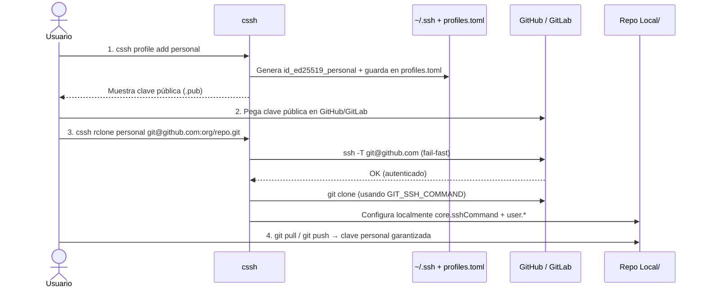

# CSSH

> **Gestor de perfiles SSH y atadura de identidad por repositorio en Git.**

[](https://golang.org)
[](LICENSE)

CSSH es una herramienta CLI en Go para gestionar perfiles SSH y clonar repositorios Git atándolos automáticamente a su perfil respectivo. 

---

## ¿Por qué CSSH?

El manejo de múltiples cuentas en Git (ej. trabajo, personal, open-source) suele requerir configuraciones complejas y frágiles en `~/.ssh/config` y `~/.gitconfig` (`includeIf`, alias de hosts como `github-personal`).

**CSSH adopta una filosofía diferente:**
1. **Cero intrusión global:** No modifica `~/.ssh/config` ni `~/.gitconfig`. Tu entorno global permanece intacto.
2. **Atadura local por repositorio:** Al clonar con `cssh rclone`, CSSH ata el repositorio configurando en `.git/config` local:
   - `core.sshCommand = "ssh -i <clave> -o IdentitiesOnly=yes"`
   - `user.name = "<nombre>"`
   - `user.email = "<email>"`
3. **Persistencia transparente y portable:** Guarda los perfiles en `profiles.toml` (`0700` dir / `0600` archivo) usando la convención `~/` para que tu configuración sea portable entre máquinas y sincronizable vía dotfiles.
4. **Sin secretos:** Nunca almacena llaves privadas ni contraseñas, solo rutas y metadatos de identidad.

---

## Flujo de Trabajo



---

## Comandos del MVP

| Comando | Descripción |
|---|---|
| `cssh profile add <perfil> [flags]` | Crea un perfil (genera automáticamente clave SSH con `ssh-keygen` o la registra). |
| `cssh profile list` | Lista todos los perfiles configurados indicando el default. |
| `cssh profile show <perfil>` | Muestra información detallada, estado en disco y clave pública. |
| `cssh profile default <perfil>` | Establece el perfil predeterminado. |
| `cssh profile remove <perfil> [--force]` | Elimina el perfil del TOML (con confirmación interactiva, sin borrar las llaves físicas). |
| `cssh rclone [<perfil>] <url> [flags]` | Clona un repositorio SSH atándolo a su identidad y clave SSH. |

---

## 🔧 Instalación y Compilación

Requiere **Go 1.27** o superior, `git` y `ssh-keygen`.

```bash
# Clonar o entrar al directorio del proyecto
cd desk/cli

# Compilar binario
go build -o cssh ./cmd/cssh

# (Opcional) Instalar en tu PATH ($GOPATH/bin)
go install ./cmd/cssh
```

---

## Guía de Uso

### 1. Crear o Registrar Perfiles

**Generar clave nueva (ed25519 por defecto):**
```bash
cssh profile add personal \
  --email "elmer@personal.dev" \
  --name "Elmer Personal" \
  --host "github.com"
```
*CSSH generará `~/.ssh/id_ed25519_personal` e imprimirá la clave pública para agregarla en GitHub.*

**Registrar una clave existente:**
```bash
cssh profile add empresa \
  --key "~/.ssh/id_rsa_work" \
  --email "elmer@empresa.com" \
  --name "Elmer Trabajo" \
  --host "gitlab.empresa.com" \
  --no-gen-key
```

### 2. Listar Perfiles

```bash
cssh profile list
```
Salida:
```text
PERFIL      DEFAULT  CLAVE                           EMAIL               GIT NAME        HOSTS
empresa              ~/.ssh/id_rsa_work              elmer@empresa.com   Elmer Trabajo   gitlab.empresa.com
personal    *        ~/.ssh/id_ed25519_personal      elmer@personal.dev  Elmer Personal  github.com
```

### 3. Ver Detalle de un Perfil

```bash
cssh profile show personal
```

### 4. Marcar Perfil por Defecto

```bash
cssh profile default empresa
```

### 5. Clonar Repositorios con `rclone`

**Resolución automática por host:**
```bash
cssh rclone git@github.com:usuario/proyecto.git
```
*Si solo el perfil `personal` reclama `github.com`, CSSH lo selecciona automáticamente.*

**Resolución explícita:**
```bash
cssh rclone personal git@github.com:usuario/proyecto.git
```

**Flags disponibles para `rclone`:**
- `--into <dir>`: Define el directorio destino.
- `--no-verify`: Omite la verificación previa `ssh -T`.
- `--dry-run`: Imprime los comandos que se ejecutarían sin aplicarlos.
- `--git-arg <arg>`: Permite pasar argumentos adicionales a `git clone` (ej. `--git-arg --depth=1`).

---

## Archivo de Configuración (`profiles.toml`)

Ubicado deterministamente en `$CSSH_CONFIG_DIR/profiles.toml` o en `~/.config/cssh/profiles.toml`:

```toml
default = "personal"

[profiles.empresa]
  key   = "~/.ssh/id_rsa_work"
  email = "elmer@empresa.com"
  name  = "Elmer Trabajo"
  hosts = ["gitlab.empresa.com"]

[profiles.personal]
  key   = "~/.ssh/id_ed25519_personal"
  email = "elmer@personal.dev"
  name  = "Elmer Personal"
  hosts = ["github.com"]
```

---

## Pruebas

Para ejecutar toda la suite de pruebas unitarias e integrales:

```bash
cd desk/cli
go test -v ./...
```

---

## Licencia

Distribuido bajo la Licencia MIT. Consulta [LICENSE](LICENSE) para más detalles.
