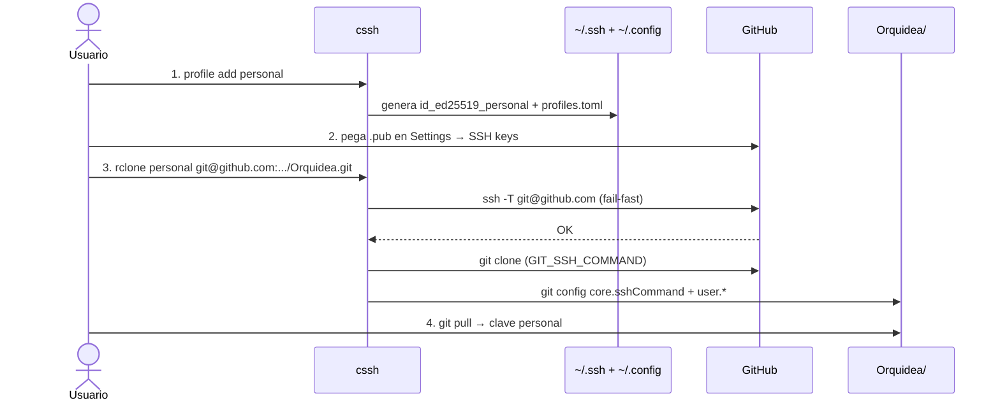

# CSSH

## QUE ES?

CSSH en su MVP es un CRUD de perfiles SSH más un clonador de repos que ata cada repo a su perfil.

CSSH es un gestor de perfiles SSH y una sintaxis corta para usar esos perfiles en cualquier herramienta que hable SSH — con el caso Git como el más importante, porque ahí la elección de perfil queda grabada en el propio repositorio.

## COMO SE USA?

| Comando | Qué hace |
|---|---|
| `cssh profile add <perfil> [flags]` | Crea perfil (genera/registra clave) |
| `cssh profile list` | Lista perfiles |
| `cssh profile show <perfil>` | Detalle de un perfil |
| `cssh profile default <perfil>` | Marca perfil como default |
| `cssh profile remove <perfil> [--force]` | Elimina perfil del TOML |
| `cssh rclone [<perfil>] <url> [flags]` | Clona repo atado a un perfil |

Seis comandos. Ese es el MVP completo en modo no interactivo.

## QUE NO ES?

- No es "solo para repos". (MVP)
    - No toca ~/.ssh/config ni ~/.gitconfig.
- No es un reemplazo de SSH.
- No es un llavero de claves suelto.
- No es un gestor de ssh-agent.

